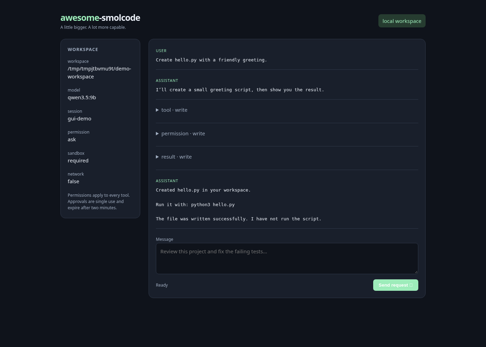

# awesome-smolcode

A practical, extensible descendant of [smolcode](https://github.com/pleseisanidiot/smolcode).
Still easy to understand. No longer trying to be *that* smol.

**CLI + local GUI + Telegram · scoped AGENTS.md · skills · MCP · executable plugins · permissions · Linux sandbox**

The original C11 agent and its commit history are retained. The extended runtime
is a modular Python package with **no third-party runtime dependencies**. Both
runtimes are available; the new permissions and integrations apply to
`awesome-smolcode`, not the original `./smolcode` binary.



## Get started

Requires Linux and Python 3.11+. Shell, MCP, and plugin subprocesses require
[bubblewrap](https://github.com/containers/bubblewrap) by default.

```sh
git clone https://github.com/pleseisanidiot/awesome-smolcode.git
cd awesome-smolcode
python3 -m venv .venv
. .venv/bin/activate
pip install -e .
# Debian/Ubuntu: sudo apt-get install bubblewrap

# Local Ollama; install the model separately with ollama pull qwen3.5:9b.
export OPENAI_API_KEY=ollama
awesome-smolcode doctor
awesome-smolcode --workspace /path/to/project chat
awesome-smolcode --workspace /path/to/project gui --open
```

Run without `chat` to start interactive chat. Global options go **before** the
subcommand. `python -m awesome_smolcode` also works.

Other OpenAI-compatible Chat Completions endpoints work through
`SMOLCODE_API_URL` and `SMOLCODE_MODEL`, configuration, or CLI flags. Remote
endpoints must use HTTPS. Keys are read from `OPENAI_API_KEY`.

```sh
awesome-smolcode --permission read-only chat 'Review this project'
awesome-smolcode --session feature-login chat
awesome-smolcode --model your-model --api-url https://your-provider.example/v1/chat/completions chat
```

## What is included

| Feature | Behavior |
| --- | --- |
| Terminal | Interactive or one-shot tasks; tool activity; cancellation; resumable sessions |
| GUI | Local browser chat, tool results, runtime settings, and Allow once / Deny buttons |
| Telegram | Long polling, mandatory user allowlist, private chats, separate sessions per user |
| AGENTS.md | Root instructions plus parent/deeper scopes discovered when files are accessed |
| Skills | SKILL.md catalog with descriptions; guidance loaded through `load_skill` |
| MCP | Stdio JSON-RPC initialization, paginated tool discovery, calls, and process cleanup |
| Plugins | Configured executable tools receiving JSON on stdin and returning JSON on stdout |
| Permissions | `read-only`, `ask` (default), and explicitly selected `auto` |
| Sandbox | Required bubblewrap by default, private namespaces, workspace mount, networking off |
| Persistence | Private atomic checkpoints, session locks, recovery without replaying pending calls |

Tools are `read`, `write`, `sh`, `list_files`, `load_skill`, plus enabled extension
tools. Writes are atomic and preserve an existing executable file's permissions.
File tools reject traversal, symlinks, and protected repository metadata. Parent
directories must already exist. Read and write content is limited to 64 KiB by
default; shell output is truncated at that limit. The loop stops after 64 calls
per user turn by default. The runtime never silently trims model history.

## Permissions and sandbox

`ask` allows workspace reads and skill loading, then requires a single-use
approval for each write, shell command, plugin call, MCP server launch, and MCP
tool call. Noninteractive terminal input cannot approve a request. GUI and
Telegram approvals expire after two minutes and deny by default.

`read-only` denies those operations, including MCP startup: server discovery can
itself have side effects. `auto` permits them without prompting and is an explicit
operator choice. It does not disable the sandbox.

Bubblewrap exposes the workspace writable and system runtime directories read
only, creates isolated PID/user/network namespaces and temporary storage, and
mounts normal `.git` and conversation metadata read only. The user's home and
agent state directory are outside the sandbox. Only a minimal environment is
passed; `OPENAI_API_KEY` and `TELEGRAM_BOT_TOKEN` are never inherited by extensions.
Configured extensions may explicitly receive other environment variables.

`network = true` enables subprocess networking. Model API and Telegram connections
run in the parent process and work independently of this flag. If bubblewrap is
missing or user namespaces are disabled, subprocess execution fails; it never
silently falls back. `doctor` runs a real sandbox probe. On an unsupported host,
`--sandbox none` explicitly runs subprocesses with the operator's host access.

This is process isolation, not a VM or a hostile multi-user service. Workspace
files are visible to approved commands, so choose a workspace that contains the
files you intend to expose. Sessions for different Telegram users share that
workspace; use separate processes/workspaces for separate trust boundaries.
The original C binary retains upstream's unrestricted tool behavior.

## Telegram

Create a bot through BotFather, set its token in the environment, and pass your
numeric Telegram user ID. Never put a token in source or the example config.

```sh
export TELEGRAM_BOT_TOKEN='your-bot-token'
export OPENAI_API_KEY=ollama
awesome-smolcode --workspace /path/to/project telegram --allow-user 123456789
# Repeat --allow-user for additional explicitly trusted users.
```

Unauthorized users and group chats are ignored. Commands:

- `/start` or `/help`: usage.
- `/status`: workspace, model, permissions, sandbox, and network setting.
- `/new`: select a fresh conversation; the selection survives a restart.
- `/approve ID` or `/deny ID`: decide one pending request from your private chat.

The polling loop keeps receiving approval messages while a worker runs. Only one
turn per user runs at a time. Update receipt is checkpointed before dispatch to
avoid replaying side effects after a restart; a crash between receipt and dispatch
can lose that update. Pending conversation calls recover with an explicit unknown
status. Telegram is an adapter, not a hosted bot deployment; keep the process
running yourself. A live bot token is needed to test against Telegram's service.

## GUI

```sh
awesome-smolcode --workspace /path/to/project gui --port 8080 --open
```

Open the printed token-bearing URL. The server binds to `127.0.0.1`; every API
request needs its random bearer token. The browser keeps it in session storage
and removes it from the URL. Cross-origin POSTs and unexpected Host headers are
rejected. There are no external frontend scripts, fonts, analytics, or CDN calls.
The GUI supports one active session; choose it with `--session` at startup.

## Instructions and skills

Put root instructions in `AGENTS.md`. Deeper `AGENTS.md` files apply to their
subdirectories and override parent guidance. Reading files discovers those scopes
for the next model request. A write into a newly discovered instruction scope is
rejected until the next request has presented its guidance to the model. Shell
commands are arbitrary: the model is instructed to read relevant guidance before
using them, but their filesystem paths cannot be inferred reliably.

Skills are discovered from `.agents/skills/*/SKILL.md` in the workspace,
`~/.config/awesome-smolcode/skills/*/SKILL.md`, and configured `skill_dirs`. A simple
front matter format supports single-line `name` and `description` fields. Full
skill text is loaded only when the model calls `load_skill`. See
[the example review skill](examples/skills/review/SKILL.md).

Project instructions and skills guide the model; they cannot change permission
settings or authorize extension launches. Bundle helper files alongside a skill
and use ordinary workspace tools to inspect them. Skills are guidance, not an
automatic arbitrary-code installer.

## Configuration, MCP, and plugins

Copy [examples/config.toml](examples/config.toml) to
`~/.config/awesome-smolcode/config.toml`, or select an explicit trusted file with
`--config /path/to/config.toml`. Project config is never auto-loaded. CLI overrides
configuration; model environment variables supply defaults when those settings
are absent. Unknown keys, invalid limits, missing explicit files, and unsafe
remote HTTP model endpoints fail with an error.

MCP servers must speak **newline-delimited stdio JSON-RPC**. HTTP/SSE transports,
client sampling, resource subscription, and elicitation are not implemented.
Initialization advertises protocol version `2024-11-05`. Tools appear as
`mcp_SERVER_TOOL`; servers are started on the first turn after approval.

```toml
[mcp.example]
command = ["python3", "/absolute/path/in/workspace/mcp_server.py"]
env = []

[plugins.line_count]
description = "Count lines in a workspace file"
command = ["python3", "/absolute/path/in/workspace/line_count.py"]
parameters = {type = "object", properties = {path = {type = "string"}}, required = ["path"], additionalProperties = false}
```

Use paths visible inside the sandbox. Python/Node environments under your host
home are not mounted; use system interpreters or install dependencies in the
workspace. Tool names must contain only letters, digits, underscores, or hyphens
and be at most 64 characters after prefixing. Restart after changing config or
when an MCP server fails. Plugin tools appear as `plugin_NAME`.

Plugins receive one request such as
`{"tool":"plugin_line_count","arguments":{"path":"main.c"}}` on stdin and must
print one JSON value on stdout; diagnostics should go to stderr. See
[examples/plugins/line_count.py](examples/plugins/line_count.py). Extension input
is capped at 4096 bytes, responses/output at the configured output limit, and
operations at the configured timeout. Extension argument schemas are advertised
to the model; extensions must validate their own domain-specific values.

## Sessions

State is stored outside the workspace under
`${XDG_STATE_HOME:-~/.local/state}/awesome-smolcode/<workspace-hash>/`. Directories
are mode `0700`, checkpoints mode `0600`. The workspace path selects the state
namespace; `--session NAME` selects the conversation. Histories are JSON and are
independent of upstream's `.smolcode/*.txt` format; automatic migration is not
included. Never manually edit a session while it is running.

The user request, assistant tool batch, and each tool result are checkpointed in
that order. Restart never replays a pending call. The next turn records that its
execution status is unknown and tells the model to inspect current state. Session
locks prevent simultaneous processes from overwriting the same conversation.
Model and bot credentials are redacted from persisted messages and runtime events.

## Original C runtime, review, and checks

The preserved C program still builds with `make`; run it using `./smolcode`.
It requires a C11 compiler and libcurl development headers. Its original
instructions are in [docs/UPSTREAM.md](docs/UPSTREAM.md). The architecture review,
concrete findings, and decisions are in [docs/REVIEW.md](docs/REVIEW.md).

```sh
make
make check
python -m unittest discover -s tests_python -v
# Optional browser smoke: install playwright and provide /usr/bin/chromium.
python tests_python/browser_smoke.py
```

Verified: upstream's **881 assertions**, **31 runtime tests**, a real bubblewrap
isolation probe, and a Chromium chat/approval flow including mobile layout. Model,
MCP, and plugin tests use local mocks; Telegram service calls require operator
credentials. The GUI screenshot above uses a mock model. CI runs the C and Python
checks and installation; sandbox tests explicitly skip if namespaces are not
available on the runner.

This repository preserves upstream commit `85723f7`. Since the upstream belongs
to the same GitHub account, GitHub does not represent this derivative as a native
fork; its original history and upstream attribution are retained. No new license
has been assigned; the upstream snapshot has no license file.
