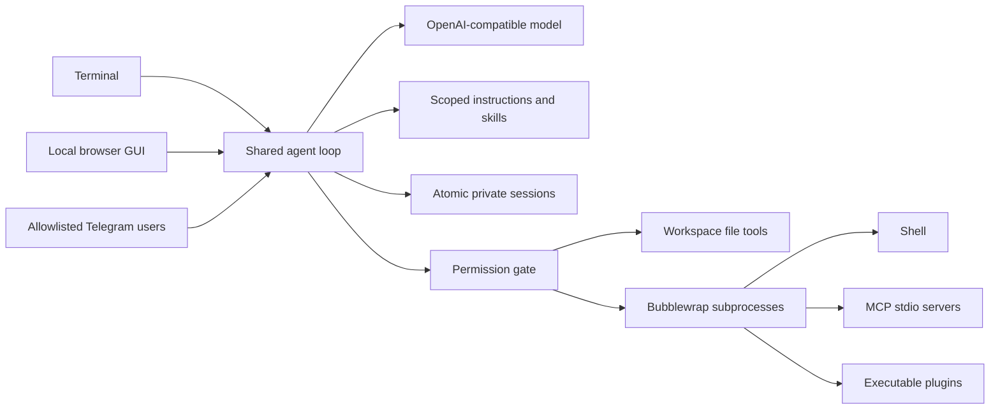

# Upstream review and implementation decisions

Reviewed `pleseisanidiot/smolcode` at commit
`85723f7b28f5079223d5cdbdd2d72b08b7b16c92` (see the repository history for the
canonical full SHA). The original sources are preserved at the repository root.
This review evaluates what must change before adding remote interfaces and
extensions; some findings are deliberate tradeoffs in the original terminal-only
program rather than departures from its documented contract.

## What upstream does well

The C11 agent has a direct, understandable split between the agent loop, HTTP
transport, JSON parser, tools, and session storage. It validates whole tool-call
batches before executing them, tracks IDs, handles provider token-parameter
fallbacks, bounds tool output, kills ordinary process groups on timeout, excludes
the model key from shell environments, and checkpoints before side effects.
Session recovery never replays pending tools. Its tests exercise actual failures,
interruptions, and protocol behavior rather than only happy paths.

`make` and `make check` passed with **881 parent-process assertions**, plus
mock-server assertions, in this workspace.

## Concrete findings

| Priority for remote use | Location at upstream commit | Finding / trigger | Extended runtime response |
| --- | --- | --- | --- |
| High | `tools.c:41`, `tools.c:80`, `tools.c:120–136` | `read`/`write` accept absolute paths and follow symlinks; `sh` runs as the operator without filesystem/network isolation. A model-selected path can reach outside the project, and a command can alter the host. `PR_SET_NO_NEW_PRIVS` only prevents privilege elevation. | File tools traverse directories using no-follow descriptors; traversal and protected metadata are rejected. Subprocesses require bubblewrap by default. All writes and subprocess operations pass through one permission layer. |
| High | `tools.c:80–99` | Writes truncate the target in place. A write or cancellation failure after truncation can leave an existing file empty or partial. | Write a temporary file, flush/fsync, preserve existing ordinary permission bits, then replace atomically. Linked targets are rejected. |
| Medium | `api.c:26–30` | The HTTP receive callback appends every response chunk without a response-body limit. A misbehaving endpoint can consume unbounded memory until allocation fails. | Limit model responses to 8 MiB; bound extension responses and reject oversized messages. |
| Medium | `json.c:95–99` | `safe_print` masks the key but prints control bytes verbatim. Model/file text containing terminal escape sequences can change terminal state, including terminal-dependent OSC behavior. | Terminal display escapes control bytes; browser rendering uses text nodes; Telegram sends plain text without parse modes. |
| Medium | `agent.c:30–31` | Arbitrary non-loopback HTTP model endpoints are accepted and receive the bearer key over cleartext HTTP. | Require HTTPS for remote model endpoints; retain HTTP for local Ollama. Reject credential-bearing URLs and redirects. |
| Capability gap | `agent.c:33–36` | Only the launch directory's AGENTS.md is loaded. Deeper project rules are absent, and there is no skill/extension registry. | Root and discovered nested scopes are presented in ancestor order; writes in an unseen scope wait until its guidance has been presented. Skill descriptions are catalogued and full guidance loads on demand. |

These responses apply to `awesome-smolcode`. The retained `./smolcode` binary
remains compatible with its original behavior and does not inherit the new
runtime's permissions or sandbox.

## Why preserve C and add a Python runtime

Putting a Telegram polling client, browser server, extension process manager,
configuration parser, and approval coordination into the tiny C loop would make
its simplicity difficult to retain. The new standard-library Python runtime
keeps the same basic message/tool/checkpoint algorithm while providing shared
interfaces and a permission gate. The existing C runtime remains buildable and
its original tests remain intact. This is an architectural extension with an
alternative runtime, not a claim that GUI/Telegram are implemented in C.

## Boundaries and remaining scope

- The default permission mode is `ask`; `read-only` also blocks MCP startup.
  Enabling `auto`, subprocess networking, or `sandbox = "none"` is an explicit
  operator configuration choice.
- This is a Linux local agent. Bubblewrap availability and namespace permissions
  depend on the host. Required isolation fails closed when unavailable.
- Workspace contents are shared by approved tools and extensions. Different
  trust boundaries should use different workspaces/processes. It is not a
  hostile multi-user hosted service.
- Instructions guide the model; arbitrary shell commands cannot be mapped to
  AGENTS.md scopes automatically. Read/write access discovers scopes, and
  first writes into unseen instruction scopes are deferred.
- MCP implements stdio tool discovery/calls. HTTP/SSE, sampling, subscriptions,
  and elicitation are outside this version. Plugin installation/update management
  is manual trusted configuration; plugins are executable JSON tools.
- Telegram uses durable receipt offsets to avoid replay on restart. Receipt
  before dispatch means an update can be lost if the process crashes between
  those two operations. `/new` selection persists. A stopped worker's pending
  calls recover without replay through the shared session layer.
- The GUI binds only to loopback and uses a bearer token, origin checks, and
  Host validation. It is intended for local use; no public deployment was made.
- Histories are not auto-trimmed; provider context limits are surfaced. The
  extended JSON sessions do not import upstream's plain-text session format.
- The upstream snapshot has no license file. This derivative does not invent
  a license grant.

## Verification

- C build and original suite: **881 assertions passed**.
- Python runtime: **31 tests passed** covering confinement, symlink and linked
  writes, atomic modes, permissions, process timeout/output, real bubblewrap
  isolation, instruction scopes, lazy skills, batching, recovery, locking,
  credential escaping, MCP/plugin protocols, approvals, GUI auth, Telegram
  filtering/session selection, HTTP fallback, and redirect rejection.
- `doctor`: real bubblewrap probe passed on the development environment.
- Chromium: rendered desktop and mobile layouts, submitted a mocked model task,
  confirmed the file did not exist before approval, approved it, observed the
  successful write and answer, and found no page errors. `docs/gui.png` captures
  that mock-backed run.
- Package installation and CLI help succeeded. CI configuration includes build,
  original tests, runtime tests, and package installation.
- No model provider or Telegram credentials were supplied, so external service
  conversations were not exercised. Local HTTP, MCP, and plugin mocks were used
  for reproducible integration checks.
